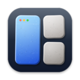

<div align="center">


# The P suite

**Apps that start with a P, each solving one real problem, built almost entirely by AI coding
agents under one author's direction. Every app is made the same way, from the first command to
the signed release.**

[srynetix.github.io/p-suite](https://srynetix.github.io/p-suite/) · free and open source, MIT OR Apache-2.0

</div>

## The apps

###  [Prism](https://github.com/Srynetix/prism)

**Your merge requests, tickets, pipelines, clusters and AI agents in one local, real-time
dashboard, sorted by what needs you.** A developer's day is spread over a dozen tabs: the forge,
the tracker, CI, the cluster, the calendar, the agents at work. Prism reads them all, live, and
answers one question first: what needs me now?

- **One window, every source.** GitLab or GitHub, ClickUp, Jira or Obsidian, Kubernetes and
  ArgoCD, your calendar and mail, Claude Code sessions.
- **Drift, caught for you.** A red pipeline on your branch, a ticket still “doing” while its MR
  is in review, an agent stuck on a permission: all in Alerts, most severe first.
- **Local, by design.** No account and no cloud. Prism reuses the access you already have: `gh`,
  `glab`, your kubeconfig and keychain.

macOS · Linux · Windows — Rust, Tauri 2, Svelte 5

###  [Pastille](https://github.com/Srynetix/pastille)

**An electronics simulator for people who have never built a circuit, and the bridge from a
circuit that works on screen to one that works on your desk.** Most circuit simulators are built
for people who already know what a node voltage is. Pastille is for the person who just bought a
starter kit and wonders why the LED did not light up.

- **See electricity move.** Dots flow with the current, every wire takes the colour of its
  voltage, from blue at 0 V to pink at the supply.
- **Mistakes, explained.** An LED the wrong way round or a short across the battery: Pastille
  says what would happen on a real bench, and how to fix it.
- **56 parts and a real Arduino.** From a battery to a 555 and a shift register, plus an Arduino
  Uno that runs a real compiled sketch. 111 examples to start from.

Browser · macOS · Windows · Linux, offline too — Rust, WebAssembly, Svelte 5

###  [Pavé](https://github.com/Srynetix/pave)

**Pave the way for your windows. A window manager for macOS that brings the switcher, snapping,
taskbar and workspaces you miss.** Switched to a Mac after years on Windows or Linux? Your hands
still reach for Alt+Tab and throw windows against the screen edges. Pavé gives them what they
expect, without fighting the Mac you chose.

- **Every window, one keystroke away.** ⌘Tab shows every window, not every app, with live
  previews. Type to search.
- **Snap, zones and tiling.** Halves and quarters on the arrows, FancyZones-style layouts for
  wide screens, tiling when you want it.
- **A real taskbar and workspaces.** A taskbar with hover previews, and workspaces that respect
  each of your screens.

macOS 15 or later — Swift 6, SwiftUI

### The next P

The suite grows one app at a time. A new one starts from the suite's [templates](templates) and
passes `just audit` before its first release.

## Different apps, one way of making them

The apps share no code. They share how they are built, so an agent that has worked on one finds
its way around the others. Every app answers to the same commands:

```bash
just doctor      # what this machine is missing
just dev         # build it and run it
just fmt         # format the sources
just ci          # the gate, before every commit
just changelog   # what changed since the last tag
just release     # a signed release on GitHub
```

- **The gate is local.** No hosted pipeline: `just ci` checks the commits, formatting, lints and
  tests on the author's machine ([ADR 0002](docs/adrs/0002-the-gate-stays-local.md)).
- **Every release is signed.** Each file ships with its `.sha256` and a minisign `.minisig`,
  under tags like `pave-v0.6.0` ([ADR 0003](docs/adrs/0003-every-release-signed.md)).
- **Decisions are written down.** Each app keeps its decision records in `docs/adrs`, and
  `AGENTS.md` tells an agent how to work on it.
- **Free to use and to fork.** Every app is under MIT OR Apache-2.0
  ([ADR 0001](docs/adrs/0001-dual-licence.md)), with Conventional Commits that become the release
  notes.

## What this repository holds

The conventions, and the files that carry them. Nothing here runs inside an app.

- [**SUITE.md**](SUITE.md) — the conventions: names, commands, the gate, decisions, the README,
  commits and releases.
- [**templates/**](templates) — the files an app starts from, or is brought in line with:
  `README.md`, `AGENTS.md`, `CLAUDE.md`, `CONTRIBUTING.md`, `SECURITY.md`, `justfile`,
  `.editorconfig`, `docs/adrs/`. Every `{{…}}` is to be replaced (`<<…>>` in the justfile and in
  scripts, where `{{…}}` is the language's own).
- [**docs/adrs/**](docs/adrs) — the decisions that hold for the whole suite.
- [**scripts/audit.py**](scripts/audit.py) — checks an app against SUITE.md, and lists what
  departs from it.
- [**docs/index.html**](docs/index.html) — the suite's page, served by GitHub Pages from `docs/`.

```bash
just audit pave              # a slug (cloned into ~/.cache/p-suite) or a path to a checkout
just audit pave --markdown   # the same, as a checklist to hand to an agent
just audit-all               # every app of the suite
```

A *must* that fails (✗) fails the audit; a *should* (!) is reported only, and an app that
keeps it gets an ADR saying why.

## License

Licensed under either of [MIT](LICENSE-MIT) or [Apache 2.0](LICENSE-APACHE), at your option.
