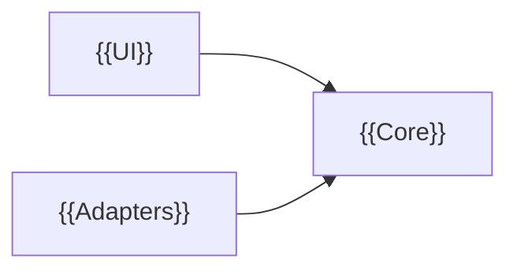
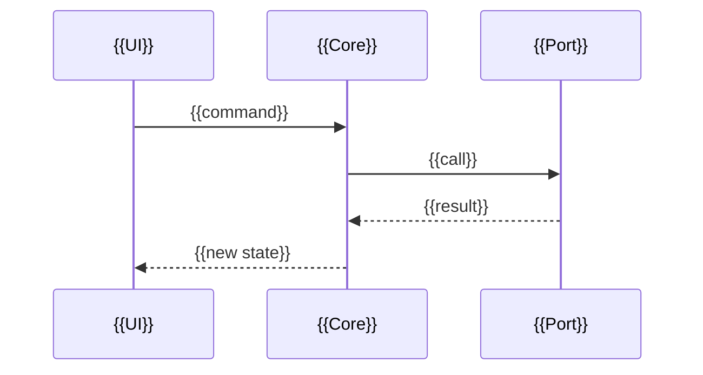

<!--
  Template from p-suite (templates/docs/dev/architecture.md, SUITE.md § 12 and § 13). Replace
  every {{…}} and delete this comment. Keep it true: a change to the structure updates it in
  the same commit.
-->

# Architecture

{{Name}} follows the suite's architecture rules ([SUITE.md § 12](https://github.com/Srynetix/p-suite/blob/main/SUITE.md#12-code)):
the domain lives in a core that knows nothing of the platform, and every dependency points
toward it.

## Layers

| Layer | Holds | Depends on | Enforced by |
|---|---|---|---|
| **Core** — [`{{path}}`]({{path}}) | The domain's types and rules, the use cases, the interfaces it needs (ports) | Nothing of the platform | {{a separate crate / target / package; a check in `just ci`}} |
| **Adapters** — [`{{path}}`]({{path}}) | The ports' implementations: {{storage, network, OS APIs…}} | Core | {{…}} |
| **UI** — [`{{path}}`]({{path}}) | What the user sees and does; no rule | Core | {{…}} |

## Modules

<!-- One line per module: what it is responsible for. A module nobody can describe in one line
     is two modules. -->

| Module | Responsible for | Depends on |
|---|---|---|
| [`{{module}}`]({{path}}) | {{one line}} | {{modules}} |

## Main flows

<!-- The two or three paths a reader needs to follow first, as sequence diagrams: a user
     action, from the UI to the core and back; a start-up; a background task. -->

### {{A user action}}

## Platform code

<!-- Where the private, unsafe, FFI or generated code lives, and the interface in front of it. -->

- {{What}}: only in [`{{path}}`]({{path}}), behind [`{{Interface}}`]({{path}}).

## Departures from § 12

<!-- Where the code does not follow the suite's rules, why, and whether it is meant to change.
     "None" is a fine answer. -->

| Where | What departs | Why | ADR |
|---|---|---|---|
| {{path}} | {{…}} | {{…}} | {{link, or —}} |
